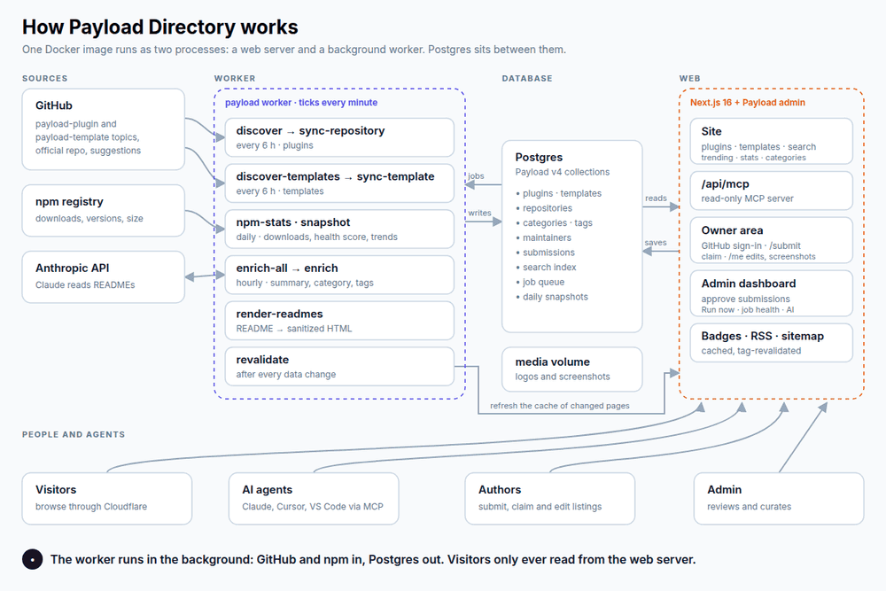

# Payload Directory

A community catalogue of [Payload CMS](https://payloadcms.com) **plugins** and **templates**. Search, filter and compare
plugins, find a starter project for your next site, and let your AI agent do the same through MCP.

**Live site:** [payloaddirectory.dev](https://payloaddirectory.dev)



---

## What's in it

- **Plugins.** Every repository with the `payload-plugin` GitHub topic, plus the official plugins from the
  `payloadcms/payload` monorepo. Each has a page with stats, a 0–100 health score, compatible Payload versions, an AI
  summary and the rendered README.
- **Templates.** Complete starter projects: Payload's official templates (discovered automatically from
  `payloadcms/payload/templates`) and community templates added by submission. Template pages have a screenshot
  gallery, a live demo link, an optional video, a "Get started" command and the README.
- **Search** across plugins and templates (`/search`), plus filters, sorting and categories on the home page.
- **Categories and tags** for plugins (`/categories`) and templates (`/templates/categories`), assigned by AI and
  curated by the admin.
- **Trending** (`/trending`): fastest-growing plugins by stars and downloads, new plugins and recent updates.
- **Stats** (`/stats`): the ecosystem at a glance (totals, health tiers, licenses, version adoption).
- **Compare** up to 3 plugins side by side.
- **For authors:** sign in with GitHub to submit a plugin or template (`/submit`), claim a listing you own, and manage
  it on `/me` (tagline, logo, links, and for templates the demo URL, video, stack and up to 8 screenshots).
- **For AI agents:** a public, read-only [MCP server](https://payloaddirectory.dev/mcp) at `/api/mcp`.
- **README badges** (`/badge/<slug>.svg`, `/badge/templates/<slug>.svg`), an **RSS feed** of the 50 newest plugins
  (`/feed.xml`), a sitemap, and light/dark themes.

---

## How it works

The diagram above is generated from [`docs/diagram/how-it-works.html`](docs/diagram/how-it-works.html) (open it in a
browser to watch it animate; a static version is [`how-it-works.png`](docs/diagram/how-it-works.png)).

One Docker image runs as two processes that share a Postgres database (and a volume for uploaded images):

- **web** — Next.js 16 with Payload 4: the public site, the admin panel, the REST API and the MCP endpoint. It never
  calls GitHub or npm while serving a page. Pages are cached and refreshed by tag when their data changes.
- **worker** — `payload worker --cron "* * * * *"`: every minute it queues the jobs that are due and runs the queue.

The flow, step by step:

1. **Discover** (every 6 hours). `discover` searches GitHub for the `payload-plugin` topic and reads the official
   plugins in the monorepo; `discover-templates` reads the official `templates/` folders and the approved community
   templates. Each queues one sync job per repository.
2. **Sync.** `sync-repository` and `sync-template` refresh repository metadata and, when the repo changed, re-read
   `package.json` (Payload version, npm package, stack) and the README. `render-readmes` turns READMEs into sanitized
   HTML.
3. **Daily jobs.** `npm-stats` (01:00 UTC) refreshes downloads, versions and sizes and recomputes the health score;
   `snapshot` (00:30 UTC) records the daily numbers behind Trending and Stats.
4. **AI enrichment** (hourly, at minute 20). `enrich-all` asks Claude for a tagline, summary, features, use cases,
   category and tags for every new or changed listing.
5. **Revalidate.** After each change the worker tells the web process which cached pages to refresh.
6. **Read.** Visitors browse through Cloudflare; agents query the same data through `/api/mcp`.
7. **People.** Authors submit and claim listings with GitHub sign-in; the admin approves them on the dashboard, which
   queues the sync.

---

## Get listed

**Plugins:** add the `payload-plugin` topic to your GitHub repository (Settings → Topics). The next discovery run (at
most 6 hours) picks it up. Plugins without the topic can be submitted at [`/submit`](https://payloaddirectory.dev/submit).

**Templates:** submit the repository (or a folder of a monorepo) at `/submit` and choose **Template**. An admin reviews it;
once approved it is synced within a minute and summarised by the next hourly AI run.

**Own a listing?** Open its page and click **Claim**. The claim is approved instantly when GitHub confirms the repository
is yours: it lives under your own account, or under an organisation where your membership is public. Otherwise an admin
reviews it. Official listings are always reviewed.
Once approved, you manage the listing on `/me`.

For best results your repo should have a clear GitHub description, a `package.json` that depends on `payload` (for
version detection) and, for plugins, a package published to npm.

---

## Use it from your AI agent (MCP)

The directory is a free, read-only MCP server. No sign-up or API key.

```bash
claude mcp add --transport http payload-directory https://payloaddirectory.dev/api/mcp
```

Setup for Claude Desktop / claude.ai, Cursor, VS Code and stdio-only clients is on
[payloaddirectory.dev/mcp](https://payloaddirectory.dev/mcp). Tools: `searchPlugins` (plugins, templates or both),
`getPlugin`, `getTemplate`, `listCategories` and `comparePlugins`.

---

## Tech stack

| Technology | Version | Purpose |
|------------|---------|---------|
| [Payload CMS](https://payloadcms.com) | 4.0.0-beta.3 (exact pin) | Data model, admin, REST API, jobs queue, MCP plugin, search plugin |
| [Next.js](https://nextjs.org) | 16 | App Router site, standalone build |
| [React](https://react.dev) | 19 | UI |
| [PostgreSQL](https://www.postgresql.org) | 18 | Database (`@payloadcms/db-postgres`) |
| [TypeScript](https://typescriptlang.org) | 6 | Types |
| [Tailwind CSS](https://tailwindcss.com) + [shadcn/ui](https://ui.shadcn.com) | 4 / new-york | Styling and components |
| [sharp](https://sharp.pixelplumbing.com) | 0.34 | Image re-encoding (logos, screenshots) |
| [Anthropic SDK](https://docs.anthropic.com) | 0.135 | AI enrichment (Claude, direct calls and Message Batches) |
| [Vitest](https://vitest.dev) | 5 | Unit and integration tests |
| Docker + [Coolify](https://coolify.io) + Cloudflare | | Hosting |

---

## Project structure

```
├── .github/workflows/
│   ├── ci.yml                  # Typecheck, lint, unit + integration tests, build
│   └── image.yml               # Builds and pushes ghcr.io/…/payload-plugins-directory:latest on main
├── docker/
│   ├── compose.yml             # web + worker services (Coolify) and the first-deploy checklist
│   └── entrypoint.sh           # web (migrates, then serves) | worker | any command
├── docker-compose.dev.yml      # Local Postgres 18 on port 5433 (dev + test databases)
├── docs/diagram/               # How-it-works diagram (HTML source, PNG, GIF, render.sh)
├── scripts/db/                 # db:pull / db:push
├── src/
│   ├── app/(site)/             # Public site: home, plugins, templates, search, categories, trending, stats,
│   │                           #   about, mcp, submit, claim, me, auth
│   ├── app/(payload)/          # Payload admin and REST API
│   ├── app/badge/, feed.xml/   # README badges, RSS
│   ├── collections/            # Plugins, Templates, Repositories, Categories, TemplateCategories, Tags,
│   │                           #   Maintainers, Submissions, Media, Users (+ hooks/)
│   ├── components/             # Site components; admin/ holds dashboard widgets and admin buttons
│   ├── endpoints/              # Custom API endpoints (health, run-job, convert-to-template)
│   ├── enrich/                 # AI enrichment: prompts, batching, locks, templates/
│   ├── lib/                    # Queries and mappers (directory/, templates/), search, submissions, auth, trends
│   ├── mcp/                    # MCP tools, guard and agent instructions
│   ├── migrations/             # Payload migrations (run on web start)
│   ├── sync/                   # Worker jobs: GitHub and npm clients, discover, sync, npm-stats, snapshot, templates/
│   ├── taxonomy/               # Starter category trees and alias tags
│   └── payload.config.ts
└── tests/                      # unit/ (no DB) and int/ (Postgres) suites
```

---

## Development

### Prerequisites

- Node.js 24 (see `.nvmrc`) and [pnpm](https://pnpm.io)
- Docker (for the local Postgres)

### Setup

```bash
git clone https://github.com/elghaied/payload-plugins-directory.git
cd payload-plugins-directory
pnpm install
cp .env.example .env               # then fill in what you need (see the comments in the file)
docker compose -f docker-compose.dev.yml up -d
pnpm payload migrate               # creates the schema and seeds the category trees
pnpm dev                           # http://localhost:3000, admin at /admin
```

To start from real data, `pnpm db:pull` copies production into the local database (see below).

### Commands

| Command | Description |
|---------|-------------|
| `pnpm dev` | Development server |
| `pnpm build` / `pnpm start` | Production build / server |
| `pnpm lint` | ESLint |
| `pnpm typecheck` | TypeScript |
| `pnpm test` | Unit tests (no database) |
| `pnpm test:int` | Integration tests (uses `DATABASE_URL_TEST` on the dev Postgres) |
| `pnpm worker` | Run the background worker locally |
| `pnpm payload migrate` | Apply migrations |
| `pnpm payload reindex-search` | Rebuild the search index |
| `pnpm payload render-readmes` | Re-render README HTML |
| `pnpm enrich:preview` | Estimate AI enrichment requests and cost without calling the API |
| `pnpm db:pull` / `pnpm db:push` | Copy the database from / to production |

Run a single test file with `pnpm exec vitest run --project unit <file>` (or `--project int`).

### Running the worker locally

1. Put `GITHUB_TOKEN`, `REVALIDATE_SECRET` and `INTERNAL_WEB_URL=http://localhost:3000` in `.env`.
2. Start the site with `pnpm dev`, then run `pnpm worker` in a second terminal.

A local worker never calls the Anthropic API unless `ENRICH_ALLOW_LOCAL=1` is set (see AI enrichment below).

---

## Background jobs

All jobs run in the worker. Job health (last success and failure per task, pending counts, GitHub quota) is shown on the
admin dashboard.

| Job | When | What it does |
|-----|------|--------------|
| `discover` | every 6 h (:00) | Searches GitHub for the `payload-plugin` topic (archived repos included) and the monorepo's `packages/plugin-*`; queues `sync-repository` per repository; moves plugins to Trash when their repository stays missing |
| `sync-repository` | queued | Refreshes repository metadata; when pushed to since the last sync, re-reads `package.json` (single package or workspaces), the Payload version, npm name and README. Rate limits re-queue the job |
| `discover-templates` | every 6 h (:15) | Queues `sync-template` for the official `templates/*` folders and every approved or listed community template. Also queued when the worker starts and there are no templates yet |
| `sync-template` | queued | Refreshes one template: metadata, folder README, last commit date, Payload version and stack (Next.js or TanStack Start) |
| `npm-stats` | daily 01:00 UTC | Downloads, latest version, size and dependency count from npm; recomputes the health score |
| `snapshot` | daily 00:30 UTC | Daily trend snapshots; also sweeps orphaned uploads |
| `render-readmes` | daily 02:15 UTC, on worker start, after README edits | Renders READMEs to sanitized HTML, out of the request path |
| `enrich-all` | hourly :20 | Finds stale plugins and templates and queues `enrich` / `enrich-template`, or submits one Message Batch for 20+ plugins |
| `revalidate` | queued | Asks the web process (`/api/revalidate`, constant-time secret check) to refresh cached pages |
| `search-resync` | queued | Updates search rows after a category or tag edit |

**Run now:** the "Sync jobs" dashboard widget has a button for each directory-wide job (discover, discover-templates,
npm-stats, snapshot, render-readmes, enrich-all) that queues it for the next worker tick. Payload's own Jobs list has
no queue action in this beta.

Nothing is fetched at request time.

### AI enrichment

- **What it writes:** tagline, summary, features, use cases, category and tags, for plugins and templates. Plugins keep
  their author description until enriched.
- **When:** `enrich-all` runs hourly. It picks listings whose content, category tree, admin instructions or model
  changed, waiting until 30 minutes after the last relevant edit (a burst of edits costs one pass). Below 20 stale
  plugins it queues direct `enrich` jobs (2 at a time); at 20 or more it submits one Message Batch (50% cost). One pass
  takes at most 500 plugins (`ENRICH_MAX_PER_PASS` overrides). While a batch is in flight it submits nothing.
  `sync-repository` also re-enriches previously enriched plugins whose content changed.
- **Settings:** Directory settings (System group) → AI: `enabled` (kill switch), `model` (default `claude-sonnet-5-5`),
  `instructions` (appended to the system prompt) and `maxNewTagsPerPlugin` (default 2, max 5).
- **Locks:** when an admin edits an AI field, that field is locked and enrichment never overwrites it. Untick the lock to
  hand it back.
- **Admin views:** the "AI enrichment" dashboard widget, and the plugin list presets "Low confidence", "Uncategorized"
  and "Enrichment failed".
- **Key:** `ANTHROPIC_API_KEY` is set on the worker only. Without it, enrichment is skipped.
- **Local workers never spend money by default:** the real client is only created when `NODE_ENV=production` or
  `ENRICH_ALLOW_LOCAL=1`. Tests never call the API (`tests/helpers/fakeEnrichClient.ts`; `vitest.setup.ts` removes the
  key and stubs `fetch`).
- **Manual commands:** `pnpm payload enrich --mode preview --limit 5` (also `pnpm enrich:preview`) estimates requests
  and cost without calling the API; `--mode queue --slugs a,b` queues `enrich` jobs; `--mode all` queues `enrich-all`
  now, ignoring the edit debounce.

### Categories and tags

Curated in the admin (Taxonomy group). The starter trees, alias tags and admin presets are created by migrations.
`pnpm payload seed-taxonomy` only adds missing starter items, applies alias tags to all plugins and lists common GitHub
topics that no alias covers.

---

## Admin

The admin lives at `/admin`. Its dashboard has three widgets:

- **Submissions:** pending listings and claims, oldest first, with **Approve**, **Reject** (optional reason the
  submitter sees on `/me`) and **Duplicate**. These go through the normal update, so approving a template listing queues
  its sync and approving a claim makes the submitter a maintainer.
- **Sync jobs:** job health and the **Run now** buttons.
- **AI enrichment:** coverage, low-confidence and failed counts, last sweep.

On a plugin, **Convert to template** moves a listing that is really a starter project to the templates collection
(official plugins excluded). Admins can upload template screenshots and edit every field; maintainers edit only their
own listings' allowed fields, through `/me`.

---

## Deployment

`docker/compose.yml` defines two services from the same image (`ghcr.io/elghaied/payload-plugins-directory:latest`,
built by GitHub Actions on every push to `main`): `web` (runs migrations, then serves) and `worker`. Both mount the same
`media` volume at `/app/media`. The first-deploy checklist (Coolify resources, environment variables, first admin,
legacy data load, Cloudflare DNS/TLS/HSTS, cache and rate-limit rules, smoke test) is the numbered list at the top of
that file.

- **Run exactly ONE worker.** Payload's `handleSchedules` is not locked across processes, so a second worker would
  queue every scheduled job twice.
- **Never enable `jobs.autoRun` on the web process** for the same reason; the worker is the only scheduler.
- The worker shuts down gracefully on SIGTERM (it finishes its current batch, up to 45 s), so redeploys do not leave jobs
  stuck in `processing`.
- At startup both processes log warnings (never secret values) for production misconfigurations: `SERVER_URL` unset or
  not `https://payloaddirectory.dev` (the site is then served with `noindex`), `REVALIDATE_SECRET` unset or shorter than
  32 characters, and for the worker `GITHUB_TOKEN`, `INTERNAL_WEB_URL` or `ANTHROPIC_API_KEY` unset. The web process also
  warns when `SESSION_SECRET` is short or unset (maintainer sign-in fails closed), when the GitHub OAuth app is not
  configured, and notes when `GITHUB_WEB_TOKEN` is unset.
- `GITHUB_WEB_TOKEN` (web only, optional): a fine-grained PAT with public-repositories read-only access. It raises claim
  ownership checks from 60 to 5,000 GitHub requests per hour. The web process never uses the worker's `GITHUB_TOKEN`.

### Database copies (`db:pull` / `db:push`)

`pnpm db:pull` replaces the local database with a copy of production. `pnpm db:push` does the reverse after a typed
`production` confirmation and a fresh backup of the target: it requires `DB_REMOTE_PRODUCTION_CONTAINER`,
`DB_REMOTE_PRODUCTION_WEB_CONTAINER` and `DB_REMOTE_PRODUCTION_WORKER_CONTAINER`, stops the worker during the restore,
migrates, and revalidates every page through `/api/revalidate` (falling back to clearing the Next data cache and
restarting web if that call fails). Run both from the main checkout: the local dump runs in the
`docker-compose.dev.yml` compose project of the current directory.

### One-time import of the legacy data

The JSON files the original GitHub Action produced are no longer in the repository. To import them once (slugs
preserved, blocklisted plugins hidden), recover them from git history:

```bash
rev=$(git log -1 --format=%h --diff-filter=D -- data/blocklist.json)
git show "$rev^:data/plugins.json" > /tmp/plugins.json
git show "$rev^:data/blocklist.json" > /tmp/blocklist.json
pnpm payload seed --file /tmp/plugins.json --blocklist /tmp/blocklist.json
```

The seed queues a discover run. In a container, copy the files in with `docker cp` and run
`npx payload seed --file <path>` from `/app/cli`.

---

## Contributing

Contributions are welcome:

1. Fork the repository and create a branch.
2. Make your change with tests (`pnpm test`, and `pnpm test:int` when it touches the database).
3. Run `pnpm typecheck` and `pnpm lint`.
4. Open a pull request explaining what changed and why.

Ideas: better health scoring, more filters, template trends, accessibility and mobile polish, translations.

---

## License

This project is open source. See the repository for license details.
